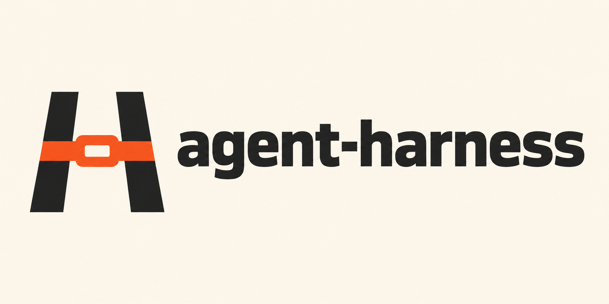

# 

Portable agent skills, scripts, and conventions maintained across projects.
Public skills are adapted deliberately, with sources and revisions tracked in [the registry](registry/skills.json).
Project-specific instructions stay in their projects.

## Install skills

This repository is public. Installation requires Node 22.20 or newer, npm/npx, and Git.
List the available skills, then install a selected skill from `main` inside your target project:

```sh
npx skills@1.7.0 add jaki95/agent-harness --list
npx skills@1.7.0 add 'jaki95/agent-harness#main' --skill grill-me --agent codex
```

See [Installation and upgrades](docs/installation.md) for global installs, release pins, updates, and rollback.

## Use Harness

[Harness](skills/harness/SKILL.md) is the working mode for selective explanations, milestone updates, and task playbooks.
Invoke it with `$harness` in Codex or `/harness` on hosts with skill slash commands.
Routed skills require separate installation. Harness reports missing skills and continues with its own communication rules.

Browse the [skill catalog](docs/skills.md) for writing, review, investigation, design, control, and engineering skills.

## Check the repository

Run from the repository root with Python 3.10 or newer:

```sh
python3 scripts/check.py
python3 -m unittest discover -s scripts/tests
```

For Skills CLI compatibility, use Node 22.20 or newer:

```sh
npm ci --ignore-scripts
npm run test:skills
```

The CLI test uses temporary fixtures and project-local installations.
For Statechart changes, run `npm run test:statechart` on Linux with Python 3.10+ and Node 22.20+. It tests chart generation, message parsing, the pipeline, and the CLI using recorded model-checker output. It runs offline and needs no Java installation. The upstream test corpus lives in [tests/statechart/test](tests/statechart/test/). Keep upstream test updates there and runtime updates in [skills/statechart/scripts](skills/statechart/scripts/). For the upstream test command, run `npm install --ignore-scripts --no-package-lock` and `npm test` from `tests/statechart/`. Live model-checker tests require `TLA2TOOLS` and Java.

## Maintain the collection

Runtime content lives in `skills/`. Sources and customizations live in `registry/skills.json`.
Use these guides for maintenance:

- [Adapt a skill](docs/adapting-skills.md).
- [Track upstream sources](docs/registry.md).
- [Monitor external skill updates](docs/monitoring-upstream.md).
- [Set up issue-driven adoption and follow an approval through merge](docs/upstream-operator.md).
- [Keep shared assets portable](docs/portability.md).
- [Version and release the collection](docs/versioning.md).
- [Agent maintenance instructions](AGENTS.md).
