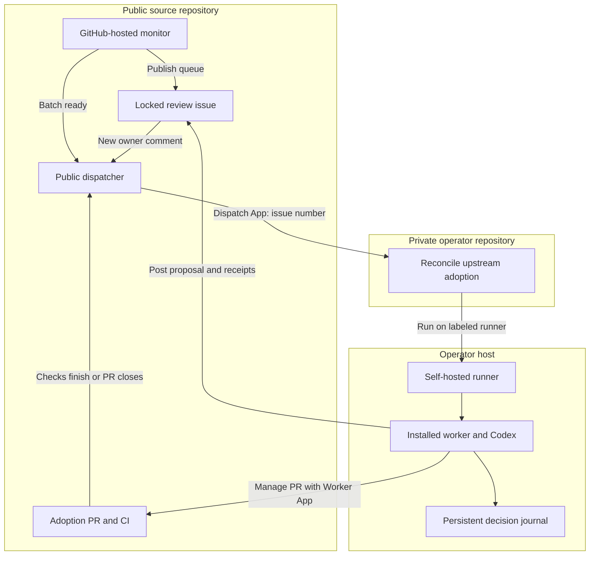
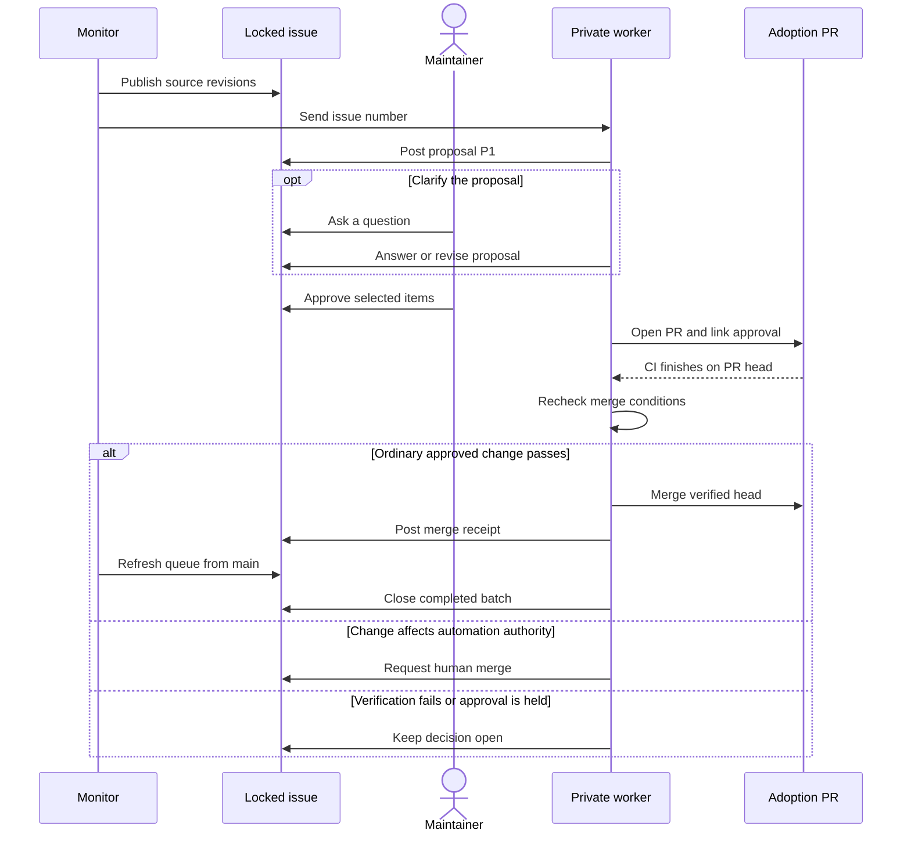

# Run issue-driven upstream adoption

The public monitor checks the upstream paths tracked in `registry/skills.json` on Mondays at 08:17 UTC, on manual dispatch, and after a push to `main` changes the registry. When it finds work, it opens a staging issue, locks the conversation, and publishes the review queue. The lock limits who can post. Anyone with access to the public repository can still read the issue.

## Where the work runs

The dispatch App can start the private workflow. The worker App can update the public issue and PR. Each wake carries an issue number. Before taking action, the worker rereads the monitor's queue, its own receipts, and original comments from the configured maintainer. Other users' comments do not enter the Codex discussion or approval history.

## Follow one approval

To approve only the first item in proposal P1, post `approve P1 item 1` as a new standalone comment. Use the version shown on the issue. The adoption PR identifies the selected sources, upstream revisions, expected behavior, and verification plan. A `keep` decision records the review in the registry and retains local skill behavior. The worker waits for a fresh detector snapshot if a merged revision still appears pending. Refresh installed skills separately after adopting runtime changes. See [approval, hold, and defer commands](monitoring-upstream.md#review-and-approve-changes-on-the-issue) and [skill upgrades](installation.md).

## Configure the two repositories

Use a private repository whose default branch is writable only by the operator. Copy [upstream-adoption.yml](../templates/upstream-operator/upstream-adoption.yml) to `.github/workflows/upstream-adoption.yml` on that branch. Create a repository-scoped Linux runner in this private repository with label `upstream-adoption`. Use a dedicated OS account with its own authenticated Codex CLI, Git, GitHub CLI, Python 3.10+, and the prerequisites for the installed worker. In the private repository, open **Settings → Actions → Runners → New self-hosted runner**, use its registration commands, add the custom label, and install the runner service for that dedicated account. Restrict repository write access to people who may operate this host. Run a single worker for the same source repository and persistent state directory. The runner connects outbound. The public repository runs its CI jobs on GitHub-hosted runners.

Install a reviewed copy of this repository, including its scripts and bundled PR helpers, at a stable, operator-controlled location on the host. Point the private job at its absolute `scripts/upstream_adoption.py` path. Keep the code read-only to the runner account. Give that account a private writable state directory outside the code install and runner workspace. The private job starts the installed worker and requires no checkout. Disallow untrusted workflows, branches and pull requests on this runner. GitHub documents [self-hosted runner isolation](https://docs.github.com/en/actions/reference/security/secure-use#hardening-for-self-hosted-runners).

Use two separate GitHub Apps. Install the dispatch App only on the private operator repository with Actions **write**. Install the worker App only on the public source repository with Actions, Contents, Issues and Pull requests **write**, and Checks and Commit statuses **read**. Read-only metadata access is implicit. Leave workflow modification, administration and rule bypass unavailable to the worker. A proposal that needs elevated authority goes to the maintainer. Protect the default branches and restrict who controls the private runner and these App credentials.

| Location | Setting | Value |
| --- | --- | --- |
| Public repository variables | `UPSTREAM_OPERATOR_OWNER`, `UPSTREAM_OPERATOR_REPO` | Private operator repository owner and bare repository name, respectively |
| Public repository variable | `UPSTREAM_ADOPTION_OWNER` | GitHub login whose issue comments may authorize work |
| Public environment `upstream-dispatch` | Variable `UPSTREAM_DISPATCH_CLIENT_ID` and secret `UPSTREAM_DISPATCH_PRIVATE_KEY` | Dispatch App client ID and PEM key |
| Private environment `upstream-worker` | Variable `UPSTREAM_WORKER_CLIENT_ID` and secret `UPSTREAM_WORKER_PRIVATE_KEY` | Worker App client ID and PEM key |
| Private environment `upstream-worker` | `UPSTREAM_SOURCE_OWNER`, `UPSTREAM_SOURCE_REPO`, `UPSTREAM_ADOPTION_OWNER` | Public repository owner, bare repository name, and the same approving GitHub login |
| Private environment `upstream-worker` | `UPSTREAM_ADOPTION_WORKER`, `UPSTREAM_ADOPTION_STATE` | Absolute paths to the installed worker script and its private state directory |

The [monitor workflow](../.github/workflows/monitor-upstream.yml) explicitly passes the named dispatch key to the [reusable dispatch workflow](../.github/workflows/dispatch-upstream-adoption.yml). Preserve that mapping when editing either workflow. A successful detection can still leave the issue without a proposal if the dispatch job cannot mint its token.

For historical batches maintained by a separate publisher, set the same `UPSTREAM_MONITOR_LOGIN` on the public repository and private environment. Optionally set `UPSTREAM_ADOPTION_MODEL` and `UPSTREAM_ADOPTION_EFFORT` on the private environment to preserve a specific Codex model and reasoning setting. The default uses the local CLI model and high effort.

Restrict each environment's deployment branches to the trusted default branch. Do this before adding the keys. Put `UPSTREAM_OPERATOR_REPO` in the **repository** variables after setup and testing. The public workflow uses this setting to enable dispatch and to leave a clean batch open for the worker's final PR receipt. Keeping it unset retains monitor-only operation. The private workflow derives the bot login from the worker App's slug. It uses the short-lived installation token for comments, PRs, CI reads and guarded merges. Keep both keys outside Git.

## Recover work after an outage

Set up a one-shot startup job for the same private runner. Jobs queued in Actions while the runner is unavailable [expire after 24 hours](https://docs.github.com/en/actions/reference/runners/self-hosted-runners#routing-precedence-for-self-hosted-runners). The startup job requests a full reconciliation from the private workflow, using the current default branch and no issue input. The worker reads the complete current conversation, including holds posted during the outage.

For a systemd-managed runner:

1. Install a dispatch App key readable only by root at `/etc/upstream-adoption/dispatch.pem`. Use a separately revocable key of the dispatch App. The startup helper needs Python 3.10+, OpenSSL, outbound HTTPS, and read access to its own installed script.
2. Copy [the reconnect service](../templates/upstream-operator/upstream-adoption-reconnect.service.tmpl) to `/etc/systemd/system/upstream-adoption-reconnect.service`. Set its private repository, dispatch client ID, Python executable and installed helper path. Keep the helper outside home directories and readable by the transient service account. Systemd supplies its key through the service credential directory.
3. Put [runner-reconnect.conf](../templates/upstream-operator/runner-reconnect.conf) in the runner service's drop-in directory. For a service named `<runner>.service`, use `/etc/systemd/system/<runner>.service.d/runner-reconnect.conf`. Run `systemctl daemon-reload`. The next runner start requests recovery. To exercise it now, start `upstream-adoption-reconnect.service` and inspect its journal and the private workflow run. A failed dispatch retries the pending wake. A successful dispatch exits.
4. On a NetworkManager host, install [the reconnect hook](../templates/upstream-operator/90-upstream-adoption-reconnect) as a root-owned executable at `/etc/NetworkManager/dispatcher.d/90-upstream-adoption-reconnect`. An interface-up, VPN-up or restored full-connectivity event requests the same catch-up, including when the runner service stayed up. On other hosts, attach the same systemd service start to the site's network-restored event. Repeated wakes replay current issue state.
5. Keep `agent-harness-upstream-review.timer` disabled. The adoption worker receives GitHub events and one startup wake.

For another process manager, run `wake_upstream_operator.py --repo OWNER/PRIVATE_REPO --client-id ID --private-key PATH` on worker startup or network restoration. If an outage produces no local network-restored event, such as a GitHub-only outage while the network remains up, request the same recovery from the private repository's Actions tab. Select **Reconcile upstream adoption**, use the default branch, and leave **issue** empty. This is also the recovery path for a lost or failed public dispatch. To wake a single batch, enter its issue number. The public monitor's **Run workflow** command also redelivers an existing open batch.

## Verify activation

Confirm a manual private dispatch with empty input reaches the dedicated runner and the worker can read the source repository under the intended App identity. For an end-to-end acceptance run in a disposable repository with separate Apps and runner state, publish a new batch, approve an ordinary item with the configured owner account, follow its PR through CI and merge, and read the final issue receipt. Post a hold before a separate approved item merges and confirm the worker honors it. A quiet run checks connectivity only. Disable new public wakes by clearing `UPSTREAM_OPERATOR_REPO`. Stop the private runner to suspend in-flight work; inspect any already-submitted GitHub merge requests separately.
